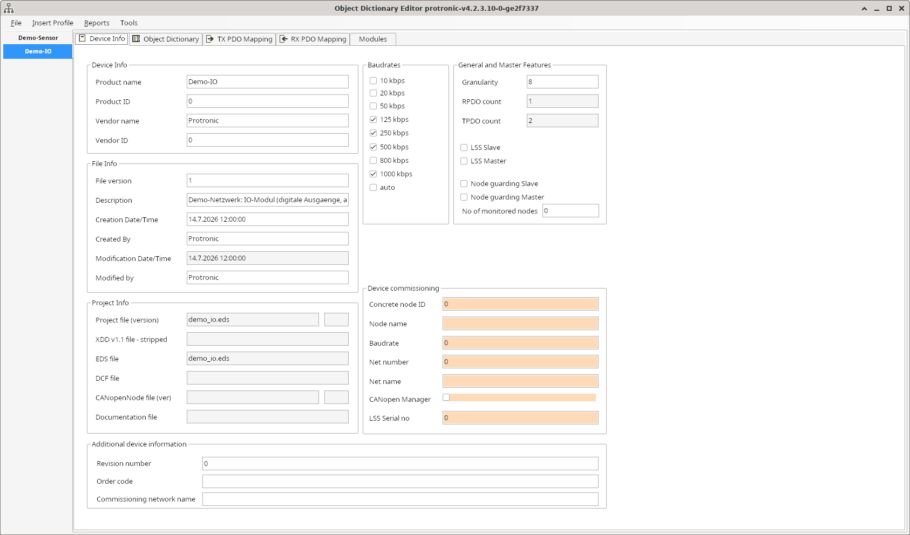
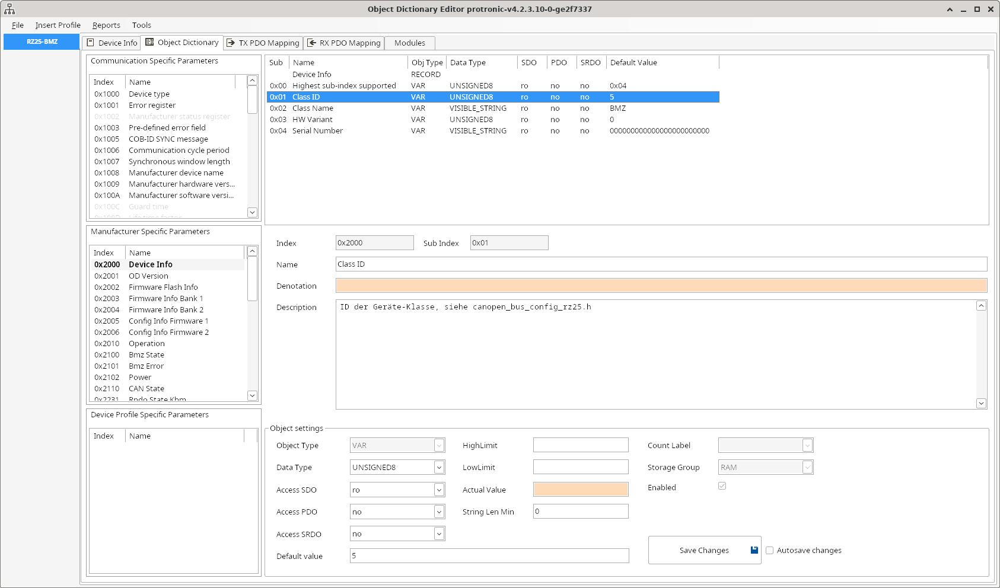
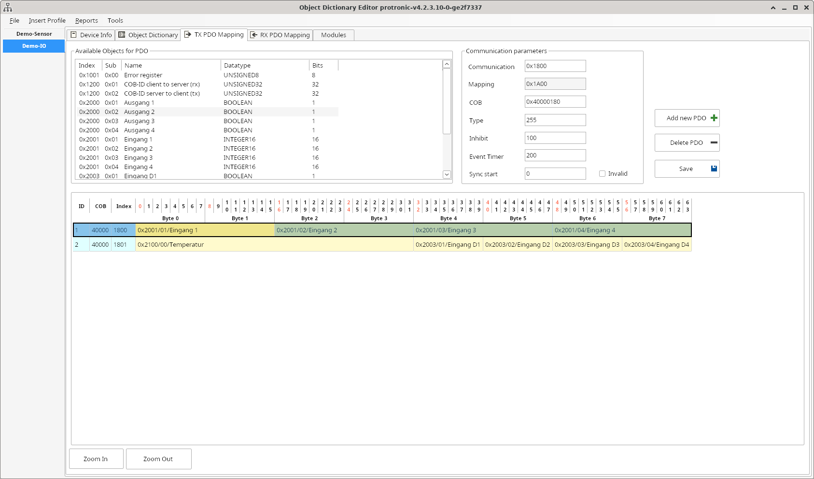
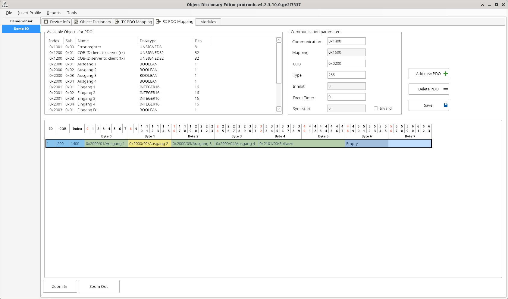

# AGENTS.md

## Role and Purpose

You are an autonomous AI coding assistant integrated into this repository. Your primary goal is to maintain code quality, implement requested features, fix bugs, and adhere strictly to the project guidelines defined in this workspace.

### Core Rules

1. Never modify configuration files or dependencies without explicit user request.
2. Always write clean, well-documented code matching the existing style of the repository.
3. Validate all changes against existing tests before confirming completion.
4. If a requirement is ambiguous, ask clarifying questions instead of guessing.

### Workflow Instructions

1. Analyze the given task or issue description thoroughly.
2. Locate the relevant files using standard file search tools.
3. Plan your implementation steps and state them briefly before writing code.
4. Implement the solution incrementally.
5. Provide a clear summary of changes made and instructions for verification.
6. Do not read the Readme.md.

## Project

The `webapp` branch contains an Angular web app that recreates the CANopen editor from `main`
in the browser. It reads and writes XDD format exclusively.

The application lives under `webapp/` and covers device information, the object dictionary,
and PDOs. Multiple devices can be open at the same time. XDD 1.0 files can be opened; saving
produces a normalized XDD 1.1 file. Additional XML fragments outside of identity,
file information, object dictionary, baud rates, and network features are not preserved.

The web UI should replicate the CANopenEditor EDSEditorGUI with the older WinForms interface.
All labels within the UI remain in their original English language and are not translated.

### Layout

The following images show the prescribed layout for each tab.

#### Tab "Device Info" 

#### Tab "Object Dictionary"

The three stacked lists "Communication Specific Parameters", "Manufacturer Specific Parameters",
and "Device Profile Specific Parameters" should each be independently collapsible.

Highlight the beginning of each list.

#### Tab "TX PDO Mapping"

#### Tab "RX PDO Mapping"

### Profiles

Provide a button for loading one or more profiles. The `EDSEditorGUI/Profiles` folder contains
files with predefined profiles for use with CANopenEditor. Offer these profiles when loading.

Provide two buttons to check all objects and to uncheck all objects. Checked objects are included in the project profile.

If an object already exists in the project file, leave it unchecked in the list. If the user checks that object again,
highlight it in the list. When the selection is saved, ask whether to overwrite the existing object.

### PDO Mapping

In the PDO mapping tab, objects for a PDO are chosen from the "Available Objects for PDO" list.
Select an element in the PDO, then select the corresponding object in the list. Selecting a PDO
element that is already assigned automatically selects the matching object in the list.

In the "Object Dictionary" tab, the sub-objects of the PDO mapping objects "TPDO mapping parameter"
and "RPDO mapping parameter" should display the name of the mapped sub-object. The label should use
the format `object-index/sub-index/name (bit width)`. The labels are saved into the project file.
